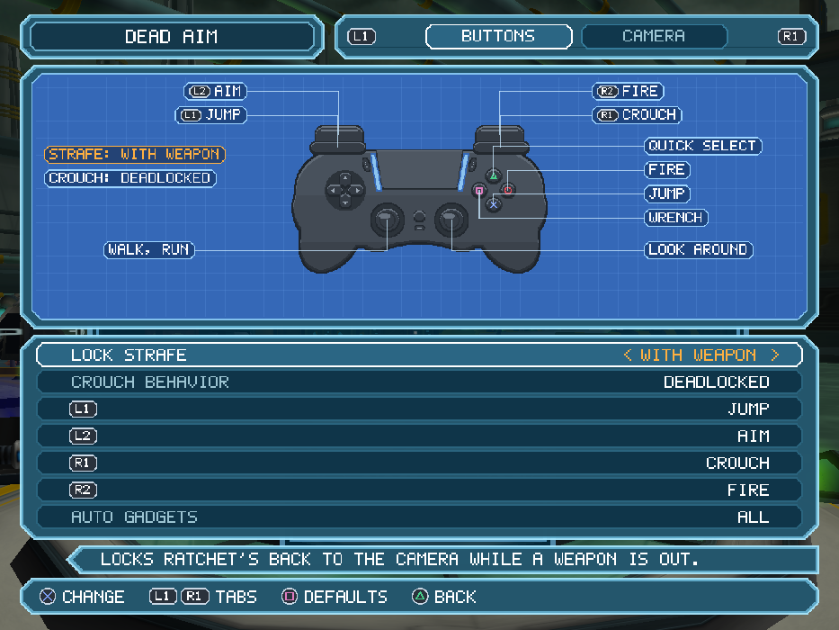
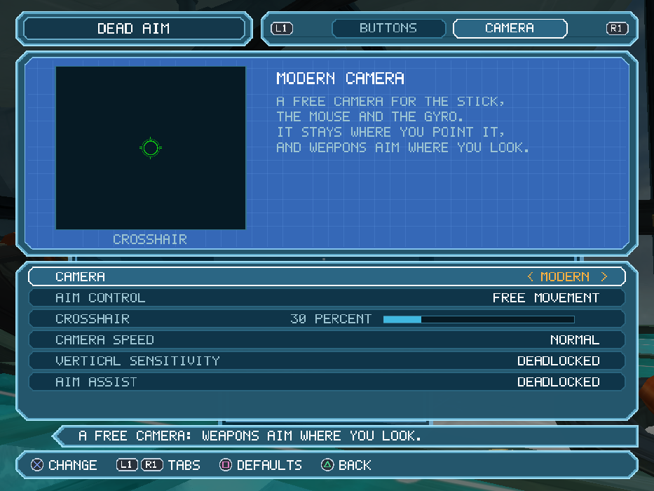

<div align="center">

# Dead Aim

### Deadlocked-style controls and camera for Ratchet & Clank: Going Commando

[](https://openrac.dev/)
[](#compatibility)
[](docs/versions.md#platforms)
[](LICENSE)

 

</div>

An [OpenRAC](https://openrac.dev/) mod that brings Going Commando's controls and camera in line with
Up Your Arsenal and Deadlocked. All settings are in **Pause → Options → Dead Aim** and in the
launcher.

## Install

1. In the OpenRAC launcher, select **Going Commando**.
2. Open **Mods → Add from a link** and paste `https://github.com/gytdoo/rac2-dead-aim`
3. Install, enable it and play.

Or download the ZIP from [Releases](https://github.com/gytdoo/rac2-dead-aim/releases) and add it with
**Mods → Add a mod**.

## Features

| Feature | What it does |
|---|---|
| Modern camera | A free camera for the stick, mouse and gyro. It stays where you point it and is kept out of walls with a swept sphere, as in Up Your Arsenal. **Classic** keeps the game's own camera. |
| Aiming | Shots go where the crosshair points. Each weapon shows its own reticle, and **Crosshair** sets their size. |
| Aim Control | **Free Movement**: holding Aim moves the view into first person and you can keep walking. **Standard**: the game's stand-still aim. |
| Lock-strafe | Ratchet keeps his back to the camera while a weapon is out, always, or never. |
| Shoulder buttons | L1, L2, R1 and R2 can each be Jump, Fire, Crouch, Aim, Wrench or Toggle strafe. |
| Crouch Behavior | **Deadlocked**: holding Crouch doesn't stop a run, so Crouch + Jump long jumps and Crouch + Square throws the wrench while running. **Joe Wrench** also throws it in the air. **Standard** is the game's crouch. |
| Auto Gadgets | Fire at a gadget's target (a Swingshot node, a Dynamo socket, something the Tractor Beam can carry, water or ice for the Thermanator, a Receiver Bot) equips and uses that gadget, then switches back to your weapon. |
| Camera speed | Deadlocked's five stick speeds. Holding the stick fully sideways turns faster, as in Deadlocked. |
| Vertical sensitivity | The vertical camera speed relative to the horizontal: Deadlocked's, Up Your Arsenal's, or your own. |
| Aim assist | Near an enemy, the stick slows down and the camera follows the target, with Deadlocked's or Up Your Arsenal's values. The mouse and gyro are not affected. |
| Tight spaces | With little room behind Ratchet, the camera moves in close and Ratchet fades out. |
| Turrets and remotes | Fire shoots turrets, and the right stick, mouse and gyro aim them. Fire detonates Spiderbots and Visibombs. |
| Hypnomatic robot | The robot uses your button layout. |
| Planetoids | The camera and aim work on the Jamming Array's planetoids. |
| Mouse and gyro | Uses OpenRAC's mouse and gyro settings where the build has them. On Linux, the gyro works with the DualSense, DualShock 4, Switch Pro Controller, Joy-Cons and Steam Deck. |

<details>
<summary><b>All settings</b></summary>

Set them in **Pause → Options → Dead Aim** (L1 and R1 switch tabs) or in the launcher.

**Buttons**

| Setting | Choices | Default |
|---|---|---|
| Lock Strafe | Off · With weapon · Always | With weapon |
| Crouch Behavior | Standard · Deadlocked · Joe Wrench | Deadlocked |
| L1 · L2 · R1 · R2 | Jump · Fire · Crouch · Aim · Wrench · Toggle strafe | Jump · Aim · Crouch · Fire |
| Auto Gadgets | Off · Swingshot · All | All |

**Camera**: with **Classic**, only the Camera row shows.

| Setting | Choices | Default |
|---|---|---|
| Camera | Modern · Classic | Modern |
| Aim Control | Free Movement · Standard | Free Movement |
| Crosshair | Off, 10–150% | 30% |
| Camera Speed | Slowest · Slower · Slow · Normal · Fast | Normal |
| Vertical Sensitivity | Deadlocked · Up Your Arsenal · Custom (30–200%) | Deadlocked |
| Aim Assist | Off · Deadlocked · Up Your Arsenal | Deadlocked |

**Mouse** and **Gyro** tabs appear only on OpenRAC builds without OpenRAC's own mouse and gyro
support.

</details>

<details>
<summary><b>Auto Gadgets, gadget by gadget</b></summary>

- **Swingshot** (with **Swingshot** or **All**): the node you look at, standing, jumping or
  hovering. It stays out while another node is in reach.
- With **All**, also the **Dynamo** at its sockets, **Tractor Beam** at what it can carry (hold Fire to carry, let go to
  drop), **Thermanator** at water and ice (hold Fire; it stays out a few seconds so you can read its
  meter), **Hypnomatic** at Receiver Bots (hold Fire until the beam takes the bot).

A gadget only comes out where the game itself would find a target for it. With two in reach, or
the gadget already in hand, Fire does what the game's Circle does.

</details>

<details>
<summary><b>Mouse and gyro, in detail</b></summary>

- **OpenRAC builds with their own keyboard, mouse and gyro**: the mod uses OpenRAC's bindings and
  settings (change them with **`** or **Start + Select**), and applies them where the Modern camera
  turns itself.
- **The gyro**: OpenRAC doesn't share its gyro with mods, so the mod reads the controller the way
  OpenRAC does, with SDL's report layouts and a port of OpenRAC's own gyro filter. It sends the
  controller no commands, follows the controller you're using, and needs read access to it (Steam's
  `steam-devices` rules give it).
- **Older builds** (the 1.1.0 release): the mod's own mouse buttons, mouse camera and gyro, in the
  Mouse and Gyro tabs. There, third-party Switch pads send no motion.
- **Outside Linux** the mod can't read the controller's gyro, so there is no Gyro tab. On
  development builds OpenRAC's own gyro still turns the game's cameras.
- **On Android** the mod leaves the mouse alone, as OpenRAC's touch controls use it: no Mouse tab.

</details>

<details>
<summary><b>Where your layout applies</b></summary>

Your layout applies on foot, in moves started on foot (jumps, ledges, the hover, grinding, the
Swingshot, Charge Boots, the Levitator) and as the Hypnomatic's robot. The game's own buttons come
back while swimming, at cranks, vendors and scenes, in vehicles, the Glider and the ship, and as
Clank or Giant Clank.

The Modern camera steps aside wherever the game frames the shot itself: other cameras (cranks,
turrets, scripted shots), grinding, bosses and arenas that set the camera, the Glider, Clank and the
robot.

</details>

## Compatibility

Going Commando USA v1.01 and v2.00, with the OpenRAC 1.1.0 release or a development build. The 1.0
releases can't load it. Built for Linux, Windows, macOS and Android; tested on Linux and Android.
See [Versions and support](docs/versions.md) for what each OpenRAC build, disc, platform and
controller gets.

> [!IMPORTANT]
> Dead Aim can't run alongside **Contextual Wrench and Fire**, **Steam Deck Pack**, **RAC-Board** or
> **Shoulder Camera**: the launcher marks the pair, and the game won't load them together. With
> Joebannerlord's **Auto Gadgets** installed, Dead Aim's own Auto Gadgets turns itself off. Every
> other Going Commando mod works alongside it.

## Status

Tested by hand on Linux, on the 1.1.0 release and development builds: the camera, aiming,
crosshairs, menus, Auto Gadgets, grinding, cranks, swimming, the Glider, the Levitator, the Charge
Boots with Deadlocked crouch, Giant Clank, the mouse and the DualSense gyro. Automated runs cover a
pass through every level, the planetoids, turrets, the Hypnomatic's robot and Crouch Behavior.
Played on Android too, with OpenRAC's touch controls.

Not yet verified: the wrench toss and Auto Gadgets on v2.00, gyro on controllers other than the
DualSense, the mod's own mouse, multiplayer parties, and Windows and macOS.
[Reports are welcome.](https://github.com/gytdoo/rac2-dead-aim/issues)

> [!NOTE]
> On planetoids, first person is Dead Aim's own, turned with the planetoid's surface: the game's
> tips toward the ground as you walk round. The menu is drawn in OpenRAC's overlay font, as mods
> can't use the game's.

<details>
<summary><b>Building from source</b></summary>

Needs Python 3, CMake 3.20+, Ninja and a C++17 compiler. `tools/fetch_sdk.py` downloads and
verifies the OpenRAC mod SDK pinned in [sdk.lock](sdk.lock).

```sh
python3 tools/fetch_sdk.py
cmake -S . -B build -G Ninja -DCMAKE_BUILD_TYPE=Release
cmake --build build
ctest --test-dir build --output-on-failure
python3 .sdk/openrac-mod-sdk-*/tools/package_mod.py build/package/rac2_dead_aim -o dist
```

Link `build/package/rac2_dead_aim` into OpenRAC's plugin folder to try a build. Pushing a tag
`v<version>` publishes a release the launcher can install. The controller drawing comes from
`tools/make_art.py` (needs Pillow), and [docs/notes](docs/notes) holds the research behind the mod.

</details>

## Credits

- **gytdoo** made Dead Aim, with Claude (Anthropic) writing much of the code.
- **[OpenRAC](https://openrac.dev/)** made the native port, the mod SDK and the
  [Going Commando](https://github.com/OpenRAC/rac2-decomp),
  [Up Your Arsenal](https://github.com/OpenRAC/rac3-decomp) and
  [Deadlocked](https://github.com/OpenRAC/rac4-decomp) decompilations the research relies on. The
  gyro filter is a port of OpenRAC's own (GPL-3.0-or-later), and controller reports follow
  [SDL](https://github.com/libsdl-org/SDL)'s layouts.
- **Joebannerlord**: Auto Gadgets is adapted from his
  [Auto Gadgets](https://github.com/Joebannerlord/openRAC-RC2-AutoGadget), and the wrench toss, the
  on-foot check and the weapon list come from his
  [Contextual Wrench and Fire](https://github.com/Joebannerlord/openRAC-RC2-contextual-wrench-throw)
  (both GPL-3.0-or-later).
- **glawks**: the Swingshot's temporary equip comes from
  [Auto Swingshot](https://github.com/glawks/auto-swingshot) (MIT, [notice](LICENSE-AUTO-SWINGSHOT)).
- **Christian**: the wrench toss's arm pose and timing come from his
  [wrench throw](https://github.com/chistianh/wrench-throw) for Ratchet & Clank.
- **Insomniac Games**: Up Your Arsenal and Deadlocked inspired the controls, the camera and the menu.

Licensed under [GPL-3.0-or-later](LICENSE). The SDK's build files and workflow carry the
[OpenRAC Mod SDK MIT notice](LICENSE-OPENRAC-SDK).
